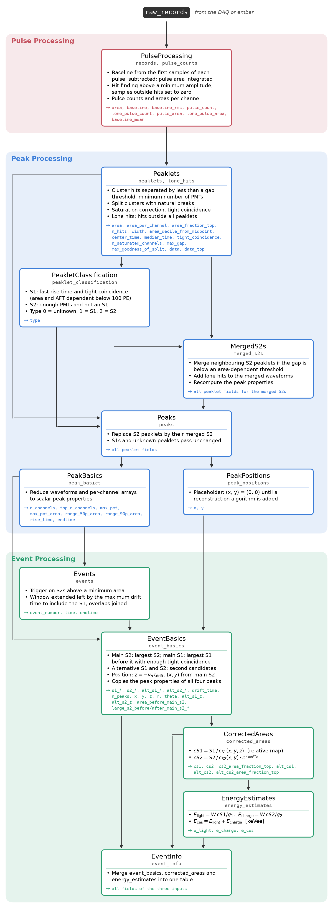

# abstrax

**A tutorial repository for building strax-based processing for dual-phase TPCs of any size.**

`abstrax` shows you how to process TPC data with [strax](https://github.com/AxFoundation/strax), using a complete, working example. It contains a full processing chain, from the digitized PMT waveforms (`raw_records`) to S1/S2 peaks to events with corrected areas and energies. A series of tutorials explains each part of it.

The plugins are ported from [straxen](https://github.com/XENONnT/straxen), XENONnT's production framework. Everything specific to XENONnT has been removed: there are no databases, no network access and no hardcoded detector numbers. All detector parameters (number of PMTs, top/bottom split, TPC geometry, drift velocity, gains, ...) live in one configuration file, [`abstrax/config/detector.yaml`](abstrax/config/detector.yaml). That way the same chain can process data from a small R&D TPC or from a detector the size of XLZD.

abstrax is not meant to be a production framework for one specific experiment. It is meant as a **starting point**: learn how strax works, run the chain on example data, then copy, adapt and extend it to build your own processing framework.

In case you build your framework based on abstrax, please cite strax and straxen as reference since most of the code originates from there.

## Tutorials

The tutorials are the core of this repository. They are Jupyter notebooks in [`tutorials/`](tutorials/) and run offline on the example data in [`test_data/`](test_data/). You need to know Python, numpy and the basics of a dual-phase LXe TPC, but nothing about strax.

| # | Notebook | What you learn |
|---|----------|----------------|
| 1 | [Introduction and data handling](tutorials/tutorial_1_intro_and_data_selection.ipynb) | What strax and abstrax are; data as a stream of time intervals; plugins, data types and data kinds; runs and chunks; contexts and storage; loading data; processing on demand; lineage; run metadata |
| 2 | [Data of LXe TPCs](tutorials/tutorial_2_data_of_lxe_tpcs.ipynb) | How the TPC signals map to data types: hit finding, peak building and peak properties, event building, position reconstruction and signal corrections |
| 3 | [Writing your own plugins](tutorials/tutorial_3_custom_plugins.ipynb) | Parts of a plugin: plugin types, `dtype`, `URLConfig` options, initialization, `compute`, fast code with numba |
| 4 | [Cuts and cut acceptances](tutorials/tutorial_4_cuts_and_cut_acceptances.ipynb) | Data quality selections with `strax.CutPlugin`, combining cuts with a `CutList` |
| 5 | [A DAQ reader](tutorials/tutorial_5_daq_reader.ipynb) | Converting the binary files of your own DAQ into `raw_records`, the entry point of the processing chain |

We recommend working through them in this order. Tutorials 1 and 2 are the basics. Tutorials 3 to 5 show how to extend the chain for your own detector.

## The processing chain



Each box is one abstrax plugin. Every box gives the data types the plugin provides, what the plugin does and, after the arrow, the fields it computes. Arrows show the data flow. The chain has three stages:

- **Pulse processing:** baseline subtraction and hit finding on the raw PMT pulses (`raw_records → records`).
- **Peak processing:** clustering hits into peaklets, S1/S2 classification, merging of S2s, and peak properties and positions (`records → peaks → peak_basics, peak_positions`).
- **Event processing:** event building around S2s, selection of the main and alternative S1/S2, corrected areas and energy estimates (`peaks → events → event_info`).

Position reconstruction (`PeakPositions`) is still a placeholder that returns (x, y) = (0, 0).

## abstrax and ember: processing and waveform simulation

[ember](https://github.com/AxFoundation/ember) is the simulation counterpart of abstrax: a strax-based waveform simulation, ported from XENONnT's fuse. It goes from energy deposits in a CSV file to `raw_records`, the same data type that abstrax starts from. Both packages read the detector parameters with the same `detector://` keys, so they can run in **one strax context**. ember then simulates the waveforms and abstrax processes them right away:

```python
import abstrax
import ember

st = ember.ember_context(output_folder="./strax_data")
st.set_config({"input_file": "beta_40keV.csv"})  # energy deposits to simulate
st.register(abstrax.contexts.ABSTRAX_PLUGINS)
st.set_config({"gain_model": "ember_pmt_to_pe://"})

events = st.get_df("000001", "event_info")  # simulation and processing in one call
```

Together they are a starting point for developing your own **processing and waveform simulation chain**:

- Put your detector's parameters into the configuration, simulate signals with ember and check how your processing reconstructs them. The simulated interactions (`microphysics_summary`) can be loaded from the same context as the processed data.
- Replace or add plugins on either side (tutorial 3) and compare the results.
- Once real data comes in, add a reader for your DAQ (tutorial 5) and run the same processing on measured and simulated data.

The tutorials of ember explain the simulation side. Its tutorial 4 runs the combined chain from a CSV file to abstrax's events.

## Adapting abstrax to your detector

1. **Detector parameters:** edit [`abstrax/config/detector.yaml`](abstrax/config/detector.yaml). Plugins read every detector-specific value from there via `detector://key` URLs. No channel count or geometry is hardcoded.
2. **Your data:** write a plugin that provides `raw_records` from your DAQ files (tutorial 5).
3. **Your processing:** register your own versions of plugins, or new ones, in the context (tutorials 3 and 4).
4. **Your maps:** replace the dummy correction maps with maps measured or simulated for your detector.

## Installation and quick start

```bash
pip install -e ".[dev]"
pytest
```

```python
import abstrax

st = abstrax.contexts.abstrax_context()
st.show_config("event_basics")  # inspect the configuration of a data type
```

Then open [tutorial 1](tutorials/tutorial_1_intro_and_data_selection.ipynb).

## Architecture

See [`docs/architecture.md`](docs/architecture.md) for the design rationale and [`CLAUDE.md`](CLAUDE.md) for development conventions.

## License

BSD-3-Clause.
